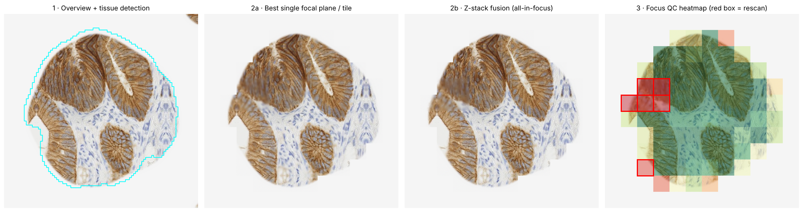
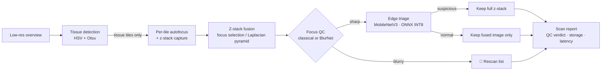
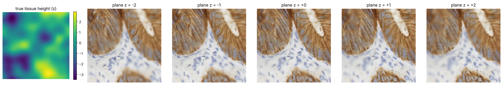
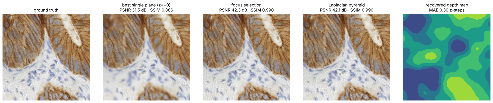

<div align="center">

# 🔬 WSI Smart Scan

### Autonomous focus QC, z-stack fusion and edge-AI triage for whole-slide imaging

*A simulation of what an intelligent slide scanner does while it scans: find the tissue, capture several focal planes, fuse them into one sharp image, catch out-of-focus tiles before a pathologist sees them, and run AI on the scanner itself to decide what is worth keeping.*



<sub>One simulated scan: tissue detection → best single focal plane vs. fused z-stack → focus-QC heatmap. Red boxes are tiles flagged for rescan: an injected autofocus failure.</sub>

</div>

---

## 📌 Problem statement

Digital pathology replaces the microscope with a **whole-slide image (WSI)**, a gigapixel scan of a glass slide. Three engineering problems decide whether that scan is usable:

| # | Problem | Why it matters | This project |
|---|---|---|---|
| 1 | **Out-of-focus scans** | Focus errors are the most common reason a scan has to be redone. If they are caught only after a pathologist opens the slide, time is already lost. | **Focus quality check (QC)**: per-tile blur scoring, a PASS / RESCAN verdict and a heatmap, run during the scan |
| 2 | **Tissue is not flat** | Sections, folds and thick cytology or microbiology samples vary in height, so a single focal plane leaves part of every field of view blurry | **Z-stack fusion**: capture several focal planes and keep the sharpest pixels → one all-in-focus image plus a tissue **depth map** |
| 3 | **Data volume** | Keeping the full z-stack for every tile multiplies storage, but throwing it away loses detail a pathologist might need | **Edge-AI triage**: a quantized CNN runs *while scanning* and keeps the z-stack only where it matters |

The scanner is **simulated with a physics-based model** (defocus blur grows with distance from the focal plane), so every stage is measured against a **known ground truth**. The learned models are trained and tested on **public pathology datasets**.

---

## 🧭 Pipeline



---

## 📊 Results

### 1 · End-to-end simulated scans (held-out)

10 simulated slides (seeds 10–19), 64 px tiles, 5 focal planes, each with an injected **autofocus failure** (e.g. debris on the coverslip making the scanner lock onto the wrong plane). The QC threshold was tuned on seeds 0–3 only.

| Metric | Result |
|---|---|
| Image quality: **best single plane → fused z-stack** | **38.8 → 47.5 dB PSNR** (+8.7 dB) · SSIM 0.978 → 0.996 |
| Autofocus failures caught by QC | **55 / 56 (98.2 %)** |
| False alarms (good tiles sent for rescan) | **9 / 687 (1.3 %)** |
| Storage vs. naive "every tile × every plane" | **−86 %** |
| Tissue height recovered from the z-stack | MAE **0.37 z-steps** |
| Processing (fusion + QC) | ~1.7 ms per 64 × 64 tile, 5 planes, 2-core cloud CPU |

<sub>Where the storage saving comes from: about half from skipping background (glass) tiles, the rest from keeping only the fused image for tiles that are in focus and not flagged. Reproduce with `python -m src.pipeline --benchmark 10-19 --out results`.</sub>

### 2 · Z-stack fusion: 16 tissue tiles × stack depth

| Focal planes | Best single plane (PSNR / SSIM) | Focus selection | Laplacian pyramid | Depth-map MAE |
|:-:|:-:|:-:|:-:|:-:|
| 3 | 30.9 dB / 0.870 | 36.4 dB / 0.958 | 36.3 dB / 0.957 | 0.56 z |
| 5 | 30.9 dB / 0.870 | **41.6 dB / 0.986** | 41.5 dB / 0.986 | 0.34 z |
| 7 | 30.9 dB / 0.870 | **44.2 dB / 0.993** | 43.9 dB / 0.992 | 0.29 z |




**Takeaways**
- A single plane can't fix uneven tissue: its quality stays flat however many planes are captured. Fusion improves with every extra plane.
- Per-pixel focus selection is slightly sharper. The Laplacian pyramid is about 1.5× faster (9 vs 14 ms per 256 px tile) and gives smoother seams.
- Focus selection also gives a **depth map** of the tissue surface for free, which is useful for predicting focus on the next tile.

### 3 · Focus quality: BlurNet vs. classical metrics

<!-- ✏️ Fill this table after running notebooks/01_scan_quality.ipynb (results/quality_results.json) -->

| Method | Params | Synthetic test SRCC ↑ | FocusPath (real scanner blur) SRCC ↑ |
|---|:-:|:-:|:-:|
| Laplacian variance | – | _run nb 01_ | _run nb 01_ |
| Tenengrad | – | _run nb 01_ | _run nb 01_ |
| Brenner | – | _run nb 01_ | _run nb 01_ |
| **BlurNet (ours)** | **16.8 k** | _run nb 01_ | _run nb 01_ |

The key test: BlurNet is trained **only on synthetic disk-PSF blur** and evaluated on **real optical defocus** from FocusPath (9 stains, 14 z-levels). The question is whether a physics-based simulation transfers to a real scanner.

### 4 · Edge triage: MobileNetV3-Small on PatchCamelyon

<!-- ✏️ Fill after running notebooks/03_edge_triage.ipynb (results/triage_results.json, results/edge_benchmark.csv) -->

| Model | Size | Test AUC | CPU latency / tile |
|---|:-:|:-:|:-:|
| PyTorch → ONNX FP32 | 6.1 MB | _run nb 03_ | _run nb 03_ |
| ONNX **INT8** (static, calibrated) | **1.7 MB** | _run nb 03_ | _run nb 03_ |

Streaming test: a mosaic of labelled PCam test tiles is scanned tile by tile. The report shows how many tumour tiles kept their z-stack (recall at the 95 %-recall operating point) and how much storage was saved.

---

## 🧠 How it works

<details open>
<summary><b>Part 1 · Focus quality check</b> — <code>src/quality.py</code></summary>

- **Classical metrics:** Laplacian variance, Tenengrad (Sobel energy), Brenner gradient, normalized variance. These are the same sharpness measures used in microscope autofocus.
- **Their weakness:** a score mixes *focus* with *how much texture the tile has*, so a sharp pale tile can score below a blurry dense one. In the pipeline they are therefore compared against the slide's median tile. Notebook 01 measures this effect.
- **BlurNet:** a 4-block fully-convolutional CNN with global average pooling (16.8 k parameters, works on any input size). It regresses an **absolute defocus radius in pixels**. It is trained on PCam patches blurred on the fly with an anti-aliased **disk point-spread function**, plus sensor noise and illumination jitter.
- **Scale matching:** FocusPath is 40× (0.25 µm/px) and PCam is about 1 µm/px. FocusPath is downsampled 4× so blur in pixels means the same physical blur in both.
- **Decision:** a tile fails if its blur score is above the threshold. The slide gets **RESCAN** if more than 5 % of tissue tiles fail.
</details>

<details>
<summary><b>Part 2 · Z-stack fusion</b> — <code>src/fusion.py</code></summary>

- **Acquisition model:** the tissue height is a slow slide warp plus local thickness changes. The defocus radius per pixel is `blur_per_z · |z_plane − height(x, y)|`, rendered by blending a bank of disk-PSF-blurred images.
- **Focus selection:** a Sum-Modified-Laplacian focus measure is averaged over a 9 × 9 window, and each pixel takes the plane with the highest response (argmax). The resulting depth index is median-filtered to remove speckle. The fused image and the depth map come out together.
- **Laplacian pyramid fusion:** at each scale, keep the detail coefficient with the largest magnitude, and average the coarsest level.
- **Metrics:** PSNR and SSIM against the known sharp image, plus depth-map MAE against the true surface.
</details>

<details>
<summary><b>Part 3 · Edge triage</b> — <code>src/triage.py</code></summary>

- MobileNetV3-Small, starting from ImageNet weights and fine-tuned on PatchCamelyon (96 × 96 H&E, tumour vs. normal).
- Exported to **ONNX**, then **INT8 static quantization** calibrated on 256 real tiles. Inference needs **ONNX Runtime only, no PyTorch**, like an embedded scanner PC.
- The operating point is chosen for **95 % recall**. Missing a tumour tile costs more than keeping one extra z-stack.
</details>

<details>
<summary><b>Part 4 · Simulated scanner</b> — <code>src/pipeline.py</code></summary>

The scanner streams tiles in scan order. For each tissue tile it runs autofocus (with jitter, plus an optional failed cluster), captures the z-stack, fuses it, scores focus QC, runs triage, and decides whether to keep the z-stack. At the end it writes a JSON scan report and figures. Ground truth is known, so the report also scores QC against the injected failures.
</details>

---

## 📁 Repository structure

```
wsi-smart-scan/
├── README.md
├── requirements.txt              # full environment (training + notebooks)
├── Dockerfile                    # lightweight inference image (ONNX Runtime, no PyTorch)
├── assets/                       # figures used in this README
├── data/
│   └── download_data.py          # PatchCamelyon + FocusPath
├── notebooks/
│   ├── 01_scan_quality.ipynb     # classical metrics vs BlurNet, real-blur test, QC heatmap
│   ├── 02_focus_fusion.ipynb     # z-stack simulation, fusion benchmark, full pipeline
│   └── 03_edge_triage.ipynb      # MobileNet training, ONNX INT8, latency, streaming triage
├── src/
│   ├── quality.py                # focus metrics, BlurNet, QC decision
│   ├── fusion.py                 # z-stack simulation + fusion methods + evaluation
│   ├── triage.py                 # PCam training, ONNX export, INT8 quantization, benchmark
│   ├── pipeline.py               # simulated end-to-end smart scan (CLI)
│   └── utils.py                  # tiling, tissue detection, colour spaces, plotting
├── api/
│   ├── main.py                   # FastAPI: /quality /fuse /triage /scan
│   └── requirements.txt
├── models/                       # trained .onnx files (created by notebooks 01 & 03)
└── results/                      # benchmark JSON / CSV
```

---

## 🚀 Quickstart

```bash
git clone <repo-url> wsi-smart-scan
cd wsi-smart-scan
pip install -r requirements.txt

# 1. no download needed: simulated scan on the bundled tissue sample
python -m src.pipeline --demo --out results/demo

# 2. reproduce the held-out benchmark (table 1)
python -m src.pipeline --benchmark 10-19 --out results

# 3. datasets for the learned models
python data/download_data.py                # PCam valid + test (~1.6 GB)
python data/download_data.py --focuspath    # optional: real scanner blur (~13 GB)
```

Then run the notebooks in order. All three run on **Google Colab** (free GPU); the first cell clones the repo automatically.

### Pipeline options

```bash
python -m src.pipeline --image region.png --tile 128 --planes 7 \
       --fusion laplacian_pyramid \
       --blur-model models/blurnet.onnx --triage models/triage_int8.onnx
```

---

## 🌐 API & Docker

```bash
uvicorn api.main:app --reload          # interactive docs at http://localhost:8000/docs
# or
docker build -t wsi-smart-scan .
docker run -p 8000:8000 wsi-smart-scan
```

| Endpoint | Input | Output |
|---|---|---|
| `GET  /health` | – | which models are loaded |
| `POST /quality` | image | focus metrics, per-tile blur grid, PASS / RESCAN, BlurNet defocus |
| `POST /fuse` | 2+ focal planes | all-in-focus PNG (+ plane-usage header) |
| `POST /triage` | tile | tumour probability, latency |
| `POST /scan` | slide region | full simulated scan report |

```bash
curl -F "file=@tile.png" http://localhost:8000/quality
curl -F "files=@z0.png" -F "files=@z1.png" -F "files=@z2.png" http://localhost:8000/fuse -o fused.png
```

---

## ⚠️ Limitations (honest notes)

- **The scanner is simulated.** Real defocus also involves optical aberrations, stain-dependent contrast and illumination changes between planes. The FocusPath test in notebook 01 checks whether the simulation transfers to real blur.
- The demo slide uses scikit-image's bundled IHC tissue image (no download needed). The learned models are trained on H&E (PatchCamelyon).
- This is a research and learning project, **not a medical device**, and it is not validated for clinical use.

## 🛣️ Next steps

- [ ] Predict the next tile's focus from the recovered depth map (fewer focal planes per tile)
- [ ] Stain normalization (Reinhard / Macenko in LAB space) before QC and triage
- [ ] Run BlurNet on a full-resolution WSI via OpenSlide and compare against HistoQC
- [ ] TensorRT / OpenVINO benchmarks on edge hardware

## 📚 References

- Hosseini, Zhang & Plataniotis. *Encoding Visual Sensitivity by MaxPol Convolution Filters for Image Sharpness Assessment.* IEEE TIP 2019 (**FocusPath**).
- Wang et al. *FocusLiteNN: High Efficiency Focus Quality Assessment for Digital Pathology.* MICCAI 2020.
- Veeling et al. *Rotation Equivariant CNNs for Digital Pathology.* MICCAI 2018 (**PatchCamelyon**).
- Howard et al. *Searching for MobileNetV3.* ICCV 2019.
- Burt & Adelson. *The Laplacian Pyramid as a Compact Image Code.* IEEE Trans. Comm. 1983.
- Nayar & Nakagawa. *Shape from Focus.* IEEE TPAMI 1994 (Sum-Modified-Laplacian).
